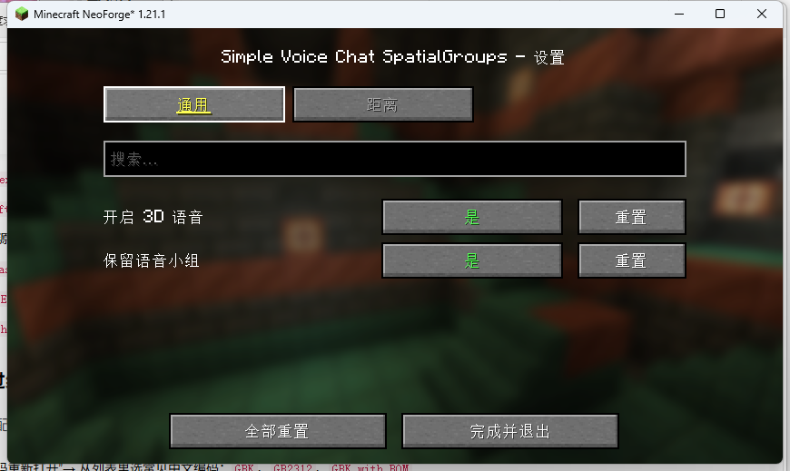
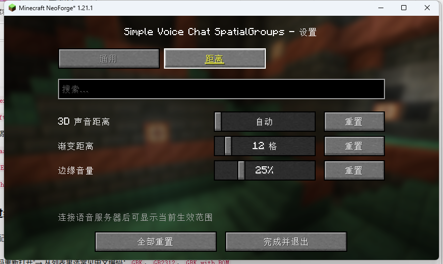
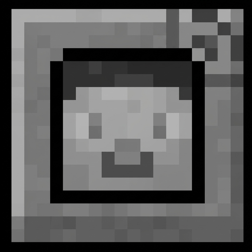

# Simple Voice Chat SpatialGroups

A mod for [Simple Voice Chat](https://github.com/henkelmax/simple-voice-chat).

## Features

### 3D Spatial Audio for Group Voice Chat

By default, Simple Voice Chat's group voice chat has no positional audio. **SpatialGroups brings 3D spatial audio to group voice chat**, allowing you to hear your teammates' voices coming from their actual in-game positions.

- Players within close range will have fully positional 3D voice audio, making conversations with nearby teammates feel much more immersive.
- At greater distances, the audio gradually transitions back to Simple Voice Chat's original non-positional group voice mode.
- The transition is handled through smooth volume blending, avoiding sudden changes or audio cutoffs.

**Default distance settings:**

- **3D Audio Distance:** Automatically uses the server's voice distance (typically 48 blocks).
- **Fade Distance:** 12 blocks.

With the default settings:

- **0–36 blocks:** Full 3D spatial audio.
- **36–48 blocks:** Smooth transition to regular group voice chat.
- **Beyond 48 blocks:** Original Simple Voice Chat group voice behavior.

### Persistent Voice Groups

Voice groups can now persist even after everyone leaves the server.

- Leaving the server no longer removes you from your voice group.
- When you rejoin the server or world, you will automatically rejoin your previous group.
- Players who manually leave a group will not automatically rejoin it.
- A group is automatically disbanded only when every member has manually left it.

After a server restart, groups and their members are restored from the configuration file.

**Save location:**
`config/spatialgroups/persistent-groups.properties`

> **Security notice:** Passwords for password-protected groups are stored in plain text in this file. Make sure your server's file permissions are properly configured.

## Configuration

Configuration file: `config/spatialgroups/common.toml` — all settings in one file.

- `[general]` — 3D audio toggle and group persistence.
- `[distance]` — 3D audio distance, fade distance, and edge volume.

### General Settings



- **Enable 3D Audio:** Enables positional audio for nearby teammates in voice groups. When disabled, group voice chat behaves exactly as it does in vanilla Simple Voice Chat.
- **Keep Groups:** When on, groups stay after players disconnect or leave the server, and you rejoin your old group next time. A group you left on purpose will not pull you back in; once its last member leaves on purpose, the group is dissolved.
  - Works immediately in singleplayer.
  - For multiplayer servers, the mod must also be installed on the server.

### Distance Settings



- **3D Audio Distance:** The maximum distance at which voices retain positional audio. Set to `0` to automatically use the server's configured voice distance.
- **Fade Distance:** The distance range over which positional audio gradually transitions back to regular group voice chat. Higher values result in a smoother, more gradual transition.
- **Edge Volume:** The minimum volume at the outer edge of the 3D audio range, preventing voices from suddenly disappearing at the boundary.

## Technical Details

- **Group Voice Chat Only:** Only group voice chat is affected. Regular proximity voice chat is completely untouched.
- **Player Microphone Audio Only:** Only audio originating from player microphones is processed. Plugin audio, music, sound effects, and spectator voice audio are not affected.
- **Audio Types:** Full positional audio is available when Simple Voice Chat's audio type is set to **Normal** (the default). The `Reduced` and `Off` modes do not use 3D positioning, so SpatialGroups leaves them unchanged.
- **Spectators / Freecam:** When the camera is detached from the player, Simple Voice Chat already uses non-positional audio. SpatialGroups does not interfere with this behavior.
- **No Occlusion:** Walls and other obstacles do not block or muffle voices. Simple Voice Chat itself does not perform occlusion calculations either.

## Compatibility

| Component | Version |
|---|---|
| Minecraft | 1.21.1 |
| Mod Loader | NeoForge 21.1.x or later |
| Tested NeoForge Version | 21.1.264 |
| Simple Voice Chat | 1.21.1-2.6.x or later |
| Mod ID | `spatialgroups` |

**Main dependency:**
- Simple Voice Chat API (compileOnly; provided at runtime by `voicechat`).

**Mod Name:** Simple Voice Chat SpatialGroups  
**Author:** Eternin



## File Verification

**File:** `simple-voice-chat-spatialgroups-neoforge-1.21.1-2.1.0.jar`

**SHA-256:**
```text
343BA9DCC643C531E339923226214A66567CBC15966739F21222245535D1D5B4
```

## License

MIT