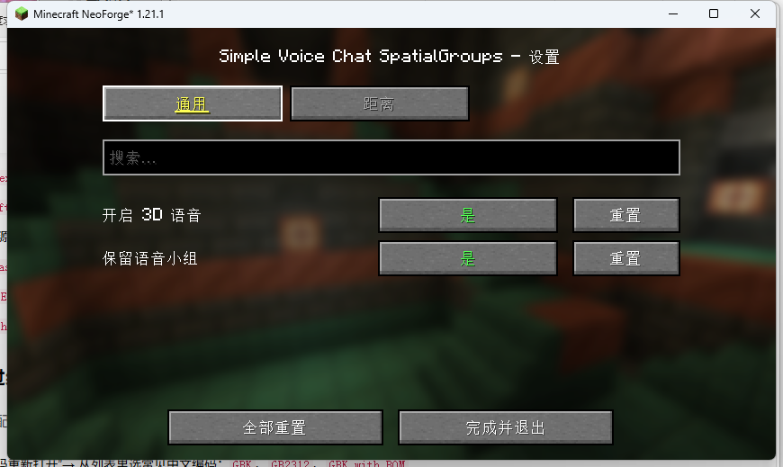
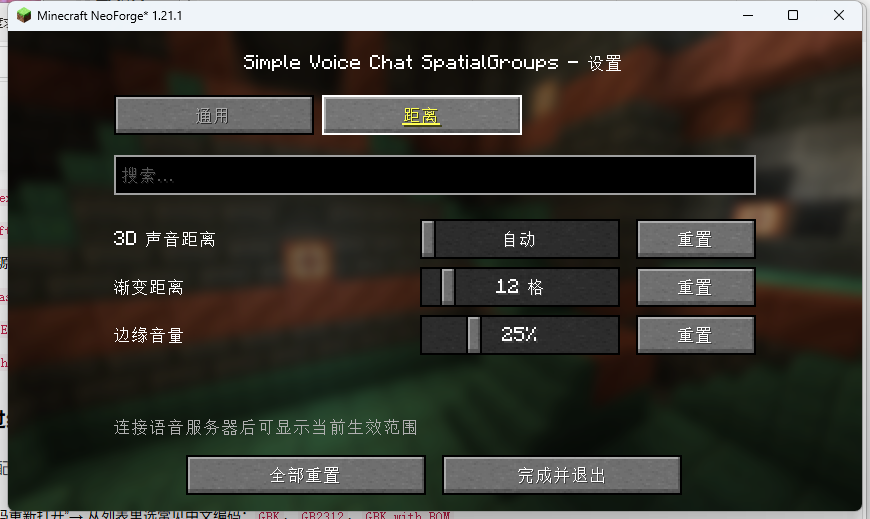
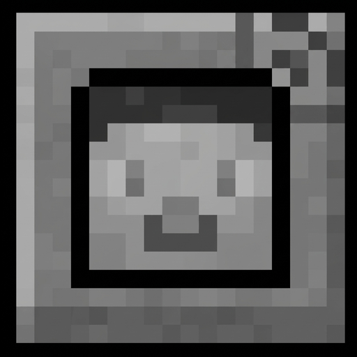

 # Simple Voice Chat SpatialGroups
一个服务于 [Simple Voice Chat](https://github.com/henkelmax/simple-voice-chat) 的模组：

- 主要功能：Simple Voice Chat 的群组语音默认没有方位感，即3D空间音效。SpatialGroups模组会在你的客户端把群组语音重新渲染成3D空间音频，群组内成员之间，近距离与同伴交流也将拥有3D空间音效，远距离保留Simple Voice Chat原本的语音模式，语音之间利用声音大小渐变实现平滑过度。
- 默认 `3D 声音距离` 自动使用服务器的语音距离（一般是 48 格），`渐变距离` 是 12 格。也就是默认 **0～36 格完整 3D，36～48 格平滑过渡，48 格以外普通群组语音**。

- 语音组的优化：离开服务器后，该组不会被解散。玩家重新进入服务器/世界时，会自动回到原来的组当中，只有当组内所有的成员都主动退出了该组，该组才会自动解散
- 服务器重启后，组和成员将从配置文件恢复。
保存位置：`config/spatialgroups/persistent-groups.properties`
> 带密码的小队，密码会以明文保存在这个文件里，请妥善设置服务器文件权限。

## 配置

- 配置文件：`config/spatialgroups/common.toml`（所有设置都在同一个文件里）
  - `[general]`：开启 3D 语音、保留语音组
  - `[distance]`：3D 声音距离、渐变距离、边缘音量





### 选项说明

**通用**

- **开启 3D 语音**：开启后，群组里近距离的队友会有方位感；关闭则和原版语音一样。
- **保留语音组**：开启后，玩家离开服务器时群组仍会保留，下次进服会自动回到这个群组; 主动退出的群组不会再自动加入。
  - 单人游戏直接生效；多人服务器也需要安装本模组。

**距离**

- **3D 声音距离**：多远以内还能听出方位感；为 0 时自动使用服务器的语音距离。
- **渐变距离**：在这个范围内声音会慢慢变回普通群组语音；数值越大越平缓。
- **边缘音量**：3D 范围边缘的最小音量，避免声音在边界突然消失。

## 细节
- **只影响群组语音**：不在群组时的普通距离语音完全不经过本模组。
- **只影响玩家麦克风语音**：插件音频、音乐、音效、观战者语音不会被处理。
- **声音类型**：Simple Voice Chat 音频类型为 **Normal**（默认）时方位效果完整；`Reduced` / `Off` 模式本身不使用 3D 定位，本模组会保持原样。
- **旁观者 / Freecam**：相机和玩家分离时，SVC 本来就使用无方位语音，本模组不介入。
- 没有墙体遮挡（Simple Voice Chat 本身也没有遮挡计算）。

主要依赖版本：
- Simple Voice Chat API（compileOnly，运行时由 `voicechat` 提供）
- 模组显示名：Simple Voice Chat SpatialGroups
- Minecraft：1.21.1
- NeoForge `21.1.264`
- 加载器：`NeoForge 21.1.x`及以上
- 依赖：Simple Voice Chat `1.21.1-2.6.x`及以上
- 模组 ID：`spatialgroups`
- 作者：Eternin



## 文件校验

`simple-voice-chat-spatialgroups-neoforge-1.21.1-2.1.0.jar` 的 SHA-256：

```
343BA9DCC643C531E339923226214A66567CBC15966739F21222245535D1D5B4
```

## License

MIT