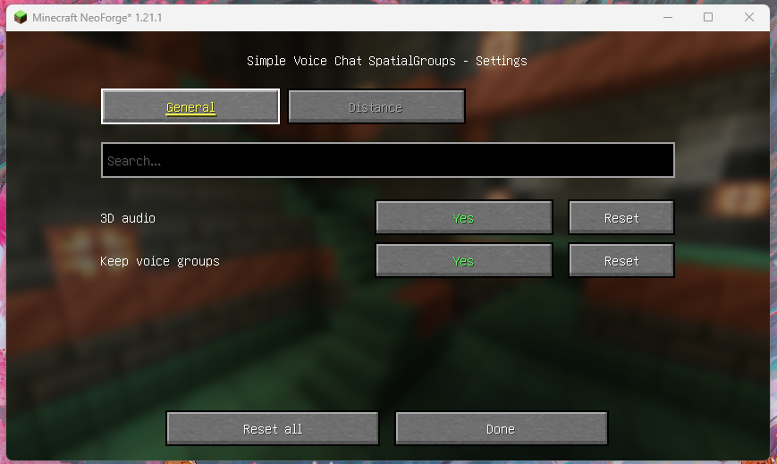
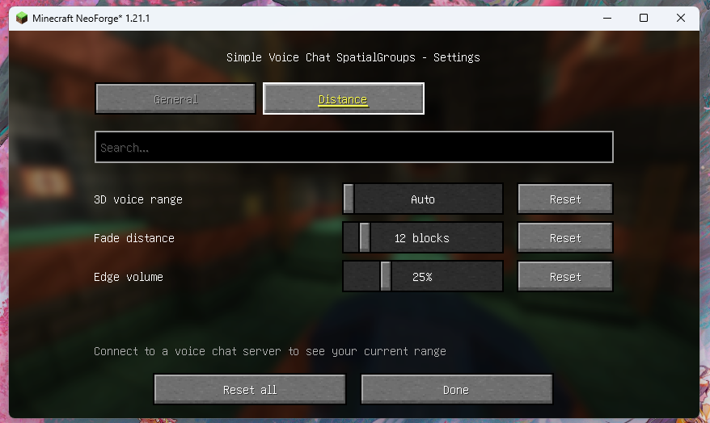

# Simple Voice Chat SpatialGroups
English | [简体中文](./README.zh.md)

A mod for [Simple Voice Chat](https://github.com/henkelmax/simple-voice-chat).

- **Main Features:** Simple Voice Chat's group voice chat does not have positional audio (3D spatial sound) by default. SpatialGroups re-renders group voice chat as 3D spatial audio on the client side, allowing you to hear your nearby teammates from their actual directions, just like regular proximity voice chat. At longer distances, the original Simple Voice Chat group audio behavior is preserved. A smooth volume transition is applied between the two ranges.

- By default, `3D Audio Distance` automatically uses the server's voice chat distance (usually 48 blocks), while `Fade Distance` is set to 12 blocks. This means:
  - **0–36 blocks:** Full 3D positional audio
  - **36–48 blocks:** Smooth transition
  - **Beyond 48 blocks:** Regular group voice chat

- **Persistent Groups:** Leaving a server no longer causes your group to be disbanded. When players rejoin the server or world, they will automatically return to their previous groups. A group is only disbanded when all members have voluntarily left it.

- Groups and their members are restored from the configuration file after a server restart.

  Save location: `config/spatialgroups/persistent-groups.properties`

  > Password-protected groups have their passwords stored in plain text in this file. Make sure your server's file permissions are properly configured.

## Configuration

- Configuration file: `config/spatialgroups/common.toml` 
  - `[general]`: Enable 3D audio and persistent groups.
  - `[distance]`: 3D audio distance, fade distance, and edge volume.





### Option Descriptions

**General**

- **Enable 3D Audio:** When enabled, nearby teammates in your group will have positional audio. When disabled, group voice chat behaves just like the original Simple Voice Chat.

- **Keep Groups:** When enabled, groups persist even after players leave the server. Players will automatically rejoin their previous groups when they return. Groups that players have manually left will not be automatically rejoined.
  - Works immediately in singleplayer. Multiplayer servers must also have this mod installed.

**Distance**

- **3D Audio Distance:** The maximum distance at which positional audio is applied. Set to `0` to automatically use the server's configured voice chat distance.

- **Fade Distance:** The distance range over which audio gradually transitions back to regular group voice chat. Higher values result in a smoother, more gradual transition.

- **Edge Volume:** The minimum volume at the outer edge of the 3D audio range, preventing audio from suddenly cutting out at the boundary.

## Annotation

- **Group Voice Chat Only:** Regular proximity voice chat outside of groups is completely unaffected by this mod.
- Main dependency: Simple Voice Chat API (compileOnly, provided at runtime by `voicechat`).
- Display Name: Simple Voice Chat SpatialGroups
- Mod ID: `spatialgroups`


## File Verification

SHA-256 checksum for `simple-voice-chat-spatialgroups-neoforge-1.21.1-2.1.0.jar`:

```text
343BA9DCC643C531E339923226214A66567CBC15966739F21222245535D1D5B4
```

## License

MIT
